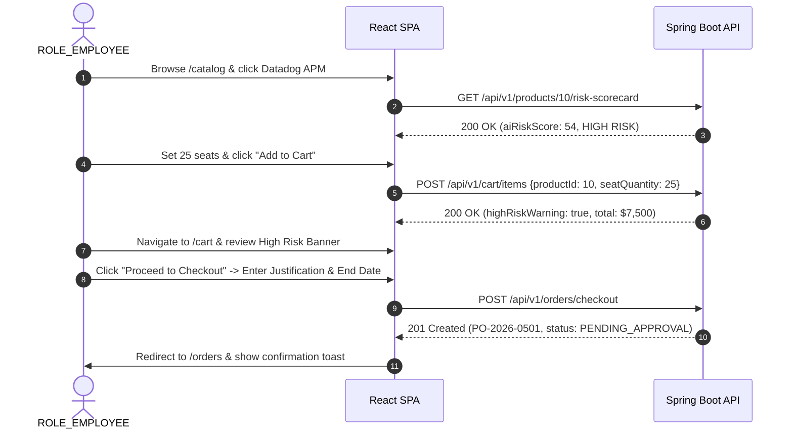
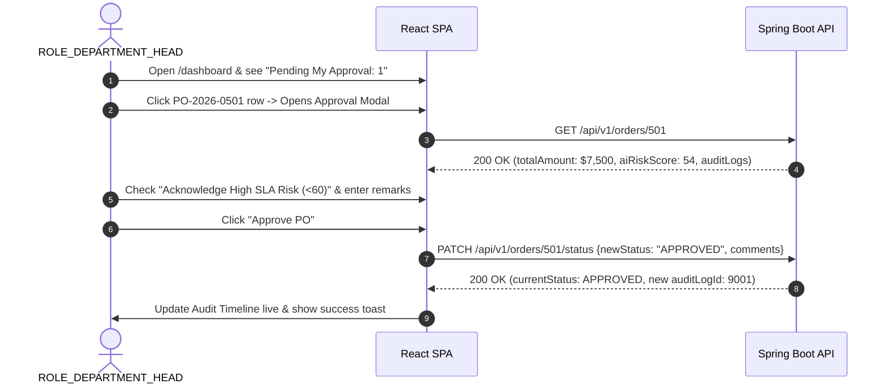
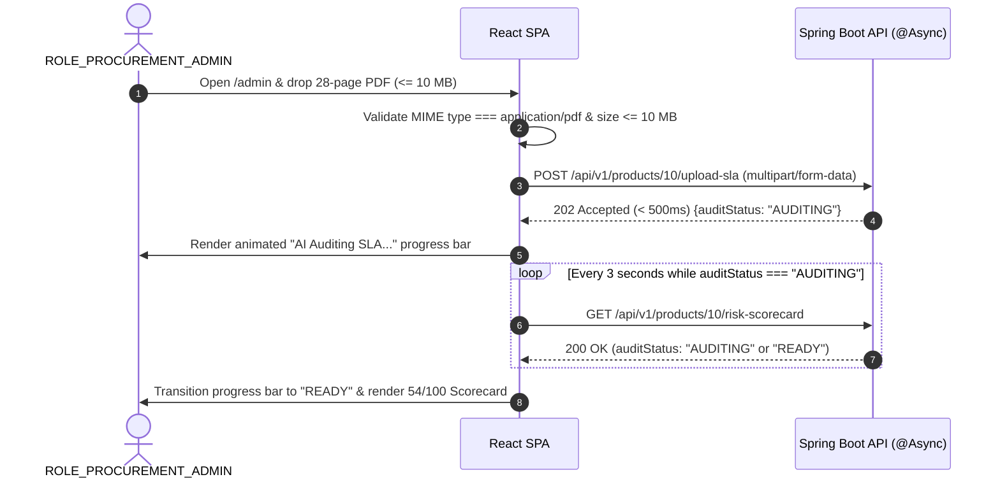

# 06_UI_FLOW.md — ProcureShield AI

## 1. Global UI Architecture & Navigation Map

### 1.1 Route Table & Role-Based Access Control (RBAC)

| Route Path | Component Name | Allowed Roles | Auth Guard | Page Title |
| :--- | :--- | :--- | :--- | :--- |
| `/login` | `LoginPage` | Public (Unauthenticated) | `PublicOnlyRoute` (Redirects authenticated users to `/dashboard`) | `Sign In — ProcureShield AI` |
| `/dashboard` | `DepartmentDashboardPage` | `EMPLOYEE`, `DEPARTMENT_HEAD`, `PROCUREMENT_ADMIN`, `AUDITOR` | `ProtectedRoute` | `Department Overview — ProcureShield AI` |
| `/catalog` | `VendorCatalogPage` | `EMPLOYEE`, `DEPARTMENT_HEAD`, `PROCUREMENT_ADMIN`, `AUDITOR` | `ProtectedRoute` | `Approved SaaS Catalog — ProcureShield AI` |
| `/catalog/:id` | `ProductDetailScorecardPage` | `EMPLOYEE`, `DEPARTMENT_HEAD`, `PROCUREMENT_ADMIN`, `AUDITOR` | `ProtectedRoute` | `Vendor & AI SLA Scorecard — ProcureShield AI` |
| `/cart` | `RequisitionCartPage` | `EMPLOYEE`, `DEPARTMENT_HEAD`, `PROCUREMENT_ADMIN` | `RoleGuard` | `Requisition Builder — ProcureShield AI` |
| `/wishlist` | `VendorShortlistPage` | `EMPLOYEE`, `DEPARTMENT_HEAD`, `PROCUREMENT_ADMIN` | `RoleGuard` | `Vendor Shortlist & Comparison — ProcureShield AI` |
| `/orders` | `PurchaseOrderListPage` | `EMPLOYEE`, `DEPARTMENT_HEAD`, `PROCUREMENT_ADMIN`, `AUDITOR` | `ProtectedRoute` | `Purchase Orders — ProcureShield AI` |
| `/orders/:poId` | `PurchaseOrderDetailModal` | `EMPLOYEE`, `DEPARTMENT_HEAD`, `PROCUREMENT_ADMIN`, `AUDITOR` | `ProtectedRoute` | `Purchase Order Review — ProcureShield AI` |
| `/admin` | `AdminGovernancePage` | `PROCUREMENT_ADMIN`, `AUDITOR` *(Read-only)* | `RoleGuard` | `Admin & SLA Governance — ProcureShield AI` |
| `*` | `NotFoundPage` | All | None | `404 Page Not Found — ProcureShield AI` |

---

### 1.2 Global Shell Layout

All authenticated routes render inside `<AppShell />`, providing persistent navigation, role-aware filtering, breadcrumb trails, and a slide-over notifications drawer.

```text
+---------------------------------------------------------------------------------------------------+
| [ProcureShield AI Logo]   Dashboard > Approved SaaS Catalog          [Bell (3)] [Role Badge] [JD] |
+-----------------------+---------------------------------------------------------------------------+
| SIDEBAR (240px)       | MAIN CONTENT VIEWPORT (Fluid 1fr, max-w-7xl mx-auto p-6)                  |
|                       |                                                                           |
| [ ] Dashboard         |  +---------------------------------------------------------------------+  |
| [x] SaaS Catalog      |  |                                                                     |  |
| [ ] Requisition Cart  |  |                    ACTIVE ROUTE PAGE CONTENT                        |  |
|     (Badge: 2)        |  |                                                                     |  |
| [ ] Vendor Shortlist  |  |                                                                     |  |
| [ ] Purchase Orders   |  |                                                                     |  |
|     (Badge: 1)        |  |                                                                     |  |
| --------------------- |  |                                                                     |  |
| ADMIN & GOVERNANCE    |  |                                                                     |  |
| [ ] SLA & Budget Ops  |  |                                                                     |  |
|     (Admin/Auditor)   |  +---------------------------------------------------------------------+  |
|                       |                                                                           |
| --------------------- |                                                                           |
| Dept: Platform Eng.   |                                                                           |
| Budget: $142,500 left |                                                                           |
+-----------------------+---------------------------------------------------------------------------+
```

#### Shell Sub-Components
1. **Persistent Top Navigation Bar (`h-16 bg-white border-b border-slate-200`):**
   - **Left:** Brand mark + dynamic Breadcrumb trail (`useMatches()` router path).
   - **Right:** Notification Bell icon with unread count badge (`GET /api/v1/notifications?unreadOnly=true`), active RBAC Role Pill (e.g., `DEPT_HEAD`), and User Profile Dropdown (Profile, Budget Summary, Sign Out).
2. **Role-Aware Sidebar (`w-60 bg-slate-900 text-slate-100`):**
   - Filters menu links dynamically from JWT `role` claim:
     - `ROLE_AUDITOR`: Hides `/cart` and `/wishlist`; displays `/admin` in read-only audit mode.
     - `ROLE_EMPLOYEE` & `ROLE_DEPARTMENT_HEAD`: Hides `/admin`.
     - `ROLE_PROCUREMENT_ADMIN`: Full navigation access.
   - Footer widget displays real-time department cost-center remaining balance (`GET /api/v1/users/me/budget`).
3. **Slide-Over Notifications Drawer (`w-96 bg-white shadow-2xl`):**
   - Triggered by clicking the top-bar Bell icon. Lists PO state transitions (`PO_STATUS_CHANGE`) and 60/30/15-day contract renewal alerts (`SLA_RENEWAL_ALERT`) with one-click `PATCH /api/v1/notifications/{id}/read`.

---

### 1.3 Design System Tokens (Tailwind CSS)

| Token Category | Semantic Name | Tailwind Class / Hex | Usage |
| :--- | :--- | :--- | :--- |
| **Brand Primary** | Indigo 600 / 700 | `bg-indigo-600 hover:bg-indigo-700` (`#4F46E5`) | Primary CTAs, active sidebar indicator, focus rings. |
| **Danger / Risk High** | Rose 600 / Rose 50 | `text-rose-700 bg-rose-50 border-rose-200` (`#E11D48`) | AI Risk Score `< 60`, rejected POs, budget overrun alerts. |
| **Warning / Risk Medium** | Amber 600 / Amber 50 | `text-amber-700 bg-amber-50 border-amber-200` (`#D97706`) | AI Risk Score `60–79`, `AUDITING` / `PENDING_APPROVAL` badges. |
| **Success / Risk Low** | Emerald 600 / 50 | `text-emerald-700 bg-emerald-50 border-emerald-200` (`#059669`) | AI Risk Score `80–100`, `APPROVED` / `COMPLETED` POs. |
| **Neutrals** | Slate 50 to 900 | `bg-slate-50` (canvas), `bg-white` (cards), `text-slate-900` | Backgrounds, borders (`border-slate-200`), body typography. |
| **Typography Scale** | Inter / JetBrains Mono | `text-2xl font-bold` (H1), `text-lg font-semibold` (H2), `text-sm` (Body), `font-mono text-xs` (PO Numbers, Txn IDs) | High legibility for financial figures and audit hashes. |
| **Border Radius & Elevation** | Rounded LG / XL | `rounded-xl` (Cards/Modals), `rounded-lg` (Inputs/Buttons), `rounded-full` (Status/Risk Pills), `shadow-sm` | Clean enterprise SaaS card hierarchy. |

---

## 2. Detailed Wireframes & Layout Specs for All 9 Screens

### Screen 1: Auth & Login (`/login`)

```text
+---------------------------------------------------------------------------------------------------+
|                                   [ProcureShield AI Shield Logo]                                  |
|                              Enterprise SaaS Procurement & Risk Portal                            |
|                                                                                                   |
|                        +-------------------------------------------------+                        |
|                        | Sign in to your workspace                       |                        |
|                        |                                                 |                        |
|                        | Corporate Email                                 |                        |
|                        | [ abhishek@procureshield.com                  ] |                        |
|                        |                                                 |                        |
|                        | Password                                        |                        |
|                        | [ ••••••••••••••••                       (Eye) ] |                        |
|                        |                                                 |                        |
|                        | [ Sign In ->                                  ] |                        |
|                        |                                                 |                        |
|                        | --- Quick Sandbox Role Switcher (Dev/Demo) ---- |                        |
|                        | [Employee] [Dept Head] [Proc Admin] [Auditor]   |                        |
|                        +-------------------------------------------------+                        |
+---------------------------------------------------------------------------------------------------+
```

- **Component Breakdown:**
  - `LoginForm`: Controlled inputs for `email` and `password` with visibility toggle.
  - `SandboxRoleQuickFill`: Optional environment-gated pill bar (`import.meta.env.VITE_ENABLE_DEMO_ROLES === 'true'`) that auto-populates demo credentials for rapid RBAC testing without bypassing backend JWT verification.
- **Data & Event Triggers:**
  - `onSubmit`: Calls `POST /api/v1/auth/login`. Stores `accessToken` in memory/AuthContext and `refreshToken` in `sessionStorage`, decodes JWT claims (`role`, `departmentId`), and navigates to `/dashboard`.

---

### Screen 2: Department Dashboard (`/dashboard`)

```text
+---------------------------------------------------------------------------------------------------+
| Department Overview: Platform Engineering (CC-ENG-101)               [+ Browse Catalog] [View POs]|
+---------------------------------------------------------------------------------------------------+
| +-----------------------------------------------------------------------------------------------+ |
| | COST CENTER BUDGET HEALTH (FY 2026)                                                           | |
| | Annual Allocation: $150,000.00   |   Spent/Committed: $7,500.00   |   Remaining: $142,500.00  | |
| | [█████░░░░░░░░░░░░░░░░░░░░░░░░░░░░░░░░░░░░░░░░░░░░░░░░░░░░░░░░░░░░░░]  5.0% Utilized          | |
| +-----------------------------------------------------------------------------------------------+ |
|                                                                                                   |
| +-------------------------------+ +-------------------------------+ +---------------------------+ |
| | Pending My Approval           | | Active High-Risk Tools        | | Upcoming SLA Renewals     | |
| |               2               | |               1               | |             1             | |
| | Action required by Dept Head  | | AI Risk Score < 60            | | Notice window <= 90 days  | |
| +-------------------------------+ +-------------------------------+ +---------------------------+ |
|                                                                                                   |
| RECENT PURCHASE ORDERS                                                                            |
| +-----------------------------------------------------------------------------------------------+ |
| | PO Number      | Vendor / Tool          | Seats | Total      | Risk Score | Status            | |
| |----------------|------------------------|-------|------------|------------|-------------------| |
| | PO-2026-0501   | Datadog Enterprise APM | 25    | $7,500.00  | [54 HIGH]  | [PENDING_APPROVAL]| |
| | PO-2026-0498   | Figma Organization     | 15    | $8,100.00  | [88 LOW]   | [COMPLETED]       | |
| +-----------------------------------------------------------------------------------------------+ |
+---------------------------------------------------------------------------------------------------+
```

- **Component Breakdown:**
  - `BudgetProgressCard`: Displays `annualBudget`, `remainingBudget`, and calculated utilization percentage bar (`emerald` `<75%`, `amber` `75–90%`, `rose` `>90%`).
  - `KpiSummaryGrid`: 3 metric cards summarizing pending approvals, high-risk subscriptions, and expiring SLA windows.
  - `RecentOrdersTable`: Compact table linking rows directly to `/orders/:poId`.
- **Data & Event Triggers:**
  - `useQuery(['userBudget'])` $\rightarrow$ `GET /api/v1/users/me/budget`
  - `useQuery(['recentOrders'])` $\rightarrow$ `GET /api/v1/orders?page=0&size=5`

---

### Screen 3: Vendor SaaS Catalog (`/catalog`)

```text
+---------------------------------------------------------------------------------------------------+
| Approved SaaS Catalog                                                    [+ Onboard Vendor (Admin)]|
+---------------------------------------------------------------------------------------------------+
| [ Search tools, vendors, or capabilities...            ]  Risk Filter: [All] [Low 80+] [High <60] |
| Categories: [All (12)] [Observability] [Security] [DevOps] [Collaboration] [Cloud Infra]          |
+---------------------------------------------------------------------------------------------------+
| +-------------------------------+ +-------------------------------+ +---------------------------+ |
| | [Logo] Datadog Inc.   [♡ Save]| | [Logo] Snyk Ltd.      [♥ Saved]| | [Logo] Slack Tech [♡ Save]| |
| | Datadog Enterprise APM        | | Snyk Enterprise Security      | | Slack Enterprise Grid     | |
| | Category: Observability       | | Category: Security            | | Category: Collaboration   | |
| |                               | |                               | |                           | |
| | AI Risk: [ 54 / 100 • HIGH ]  | | AI Risk: [ 91 / 100 • LOW  ]  | | AI Risk: [ AUDITING... ]  | |
| | Notice Window: 90 Days        | | Notice Window: 30 Days        | | Notice Window: Pending    | |
| |                               | |                               | |                           | |
| | $300.00 / seat / year         | | $420.00 / seat / year         | | $150.00 / seat / year     | |
| | [Inspect SLA]  [+ Add to Cart]| | [Inspect SLA]  [+ Add to Cart]| | [Inspect SLA]  [Disabled] | |
| +-------------------------------+ +-------------------------------+ +---------------------------+ |
+---------------------------------------------------------------------------------------------------+
```

- **Component Breakdown:**
  - `CatalogFilterBar`: Debounced search input (`300ms`), category filter pills, and AI Risk Score threshold toggle.
  - `ProductCard`: Displays vendor logo (`logoR2Url`), wishlist heart toggle, color-coded AI Risk Score pill (`READY`, `AUDITING`, `MANUAL_REVIEW_REQUIRED`), annual seat pricing, and quick actions.
- **Data & Event Triggers:**
  - `useQuery(['products', filters])` $\rightarrow$ `GET /api/v1/products?category=&maxRiskScore=&page=&size=`
  - `onAddToCart`: Calls `POST /api/v1/cart/items` with `{ productId, seatQuantity: 1 }` and invalidates `['cart']`.
  - `onToggleWishlist`: Calls `POST /api/v1/wishlist/{productId}`.

---

### Screen 4: Product Detail + AI SLA Audit Scorecard (`/catalog/:id`)

```text
+---------------------------------------------------------------------------------------------------+
| <- Back to Catalog                                       [♡ Shortlist] [View Raw SLA PDF (R2) ↗]  |
+---------------------------------------------------------------------------------------------------+
| [Logo] Datadog Enterprise APM — Datadog Inc.                          $300.00 / seat / ANNUAL     |
| Cloud monitoring and application performance observability platform.  [Seats: 25] [+ Add to Cart] |
+---------------------------------------------------------------------------------------------------+
| AI COMPLIANCE & SLA RISK SCORECARD                              Audit Status: [READY]             |
| +------------------------------------+ +--------------------------------------------------------+ |
| | OVERALL RISK SCORE                 | | KEY RISK INDICATORS                                    | |
| |                                    | | • Auto-Renewal Notice: 90 Days (High Lock-In Trap)     | |
| |           54 / 100                 | | • Data Residency Compliant: Yes (SOC2 Type II)         | |
| |         [ HIGH RISK ]              | | • Uncapped Liability Detected: Yes (Capped at $500)    | |
| +------------------------------------+ +--------------------------------------------------------+ |
|                                                                                                   |
| AI AUDITOR SUMMARY                                                                                |
| "Elevated commercial lock-in risk due to aggressive 90-day auto-renewal cancellation window."      |
|                                                                                                   |
| FLAGGED CONTRACT CLAUSES (2)                                                                      |
| [!] Section 8.2: Automatic 24-month renewal unless written notice provided 90 days prior.         |
| [!] Section 11.4: Vendor aggregate liability is capped at $500 regardless of breach severity.     |
+---------------------------------------------------------------------------------------------------+
```

- **Component Breakdown:**
  - `VendorHeaderPanel`: Product metadata, seat stepper input, `Add to Cart` CTA, and presigned Cloudflare R2 PDF viewer button.
  - `AiRiskScorecardPanel`: Renders structured `ai_risk_scorecard` JSONB payload (`overallScore`, `riskLevel`, `autoRenewalNoticeDays`, `dataResidencyCompliant`, `uncappedLiabilityDetected`, `auditorSummary`, and `flaggedClauses` list). If `auditStatus === 'MANUAL_REVIEW_REQUIRED'`, displays a `Retry AI Scan` button for `ROLE_PROCUREMENT_ADMIN`.
- **Data & Event Triggers:**
  - `useQuery(['productScorecard', id])` $\rightarrow$ `GET /api/v1/products/{id}/risk-scorecard`
  - `onRetryAudit` (Admin): Calls `POST /api/v1/products/{id}/retry-audit`.

---

### Screen 5: Requisition Cart (`/cart`)

```text
+---------------------------------------------------------------------------------------------------+
| Requisition Builder                                                  Department: Platform Eng.    |
+---------------------------------------------------------------------------------------------------+
| [!] HIGH AI CONTRACT RISK DETECTED: 1 item in your requisition has an AI Risk Score below 60.     |
|     Your Department Head will be required to acknowledge this SLA risk during PO approval.        |
+---------------------------------------------------------------------------------------------------+
| REQUISITION LINE ITEMS (1)                                         | ORDER & BUDGET SUMMARY       |
| +----------------------------------------------------------------+ | +--------------------------+ |
| | Datadog Enterprise APM (Datadog Inc.)            [54 HIGH RISK]| | | Subtotal:      $7,500.00 | |
| | Unit Price: $300.00 / seat / year                              | | | Est. Tax (0%):     $0.00 | |
| | Seats: [ - ] [ 25 ] [ + ]    Line Total: $7,500.00   [Remove]  | | | ------------------------ | |
| +----------------------------------------------------------------+ | | Total Req:     $7,500.00 | |
|                                                                    | | Dept Budget: $142,500.00 | |
|                                                                    | | Post-PO Bal: $135,000.00 | |
|                                                                    | | [✓ Within Cost Center Cap] | |
|                                                                    | |                          | |
|                                                                    | | [Proceed to Checkout ->] | |
|                                                                    | +--------------------------+ |
+---------------------------------------------------------------------------------------------------+
```

- **Component Breakdown:**
  - `HighRiskBanner`: Conditionally rendered when `cart.highRiskWarning === true` (`bg-rose-50 border-rose-300 text-rose-800`).
  - `CartLineItemRow`: Seat quantity stepper (`min=1`), unit price, line subtotal, AI risk badge, and delete icon.
  - `BudgetCheckSummaryCard`: Compares `totalEstimatedCost` against `department.remainingBudget`. Disables checkout button if `totalEstimatedCost > remainingBudget`.
- **Data & Event Triggers:**
  - `useQuery(['cart'])` $\rightarrow$ `GET /api/v1/cart`
  - `onUpdateSeats`: Calls `POST /api/v1/cart/items` with updated `seatQuantity`.
  - `onRemoveItem`: Calls `DELETE /api/v1/cart/items/{itemId}`.
  - `onProceedCheckout`: Opens Screen 8 Checkout/PO Submission Modal.

---

### Screen 6: Wishlist & Shortlist Comparison (`/wishlist`)

```text
+---------------------------------------------------------------------------------------------------+
| Vendor Shortlist & Side-by-Side Comparison (2 Bookmarked Tools)                                   |
+---------------------------------------------------------------------------------------------------+
| +-------------------------------+-------------------------------+-------------------------------+ |
| | Evaluation Criteria           | Datadog Enterprise APM        | New Relic One Enterprise      | |
| |-------------------------------|-------------------------------|-------------------------------| |
| | Vendor                        | Datadog Inc.                  | New Relic Inc.                | |
| | Annual Price / Seat           | $300.00 / yr                  | $260.00 / yr                  | |
| | AI SLA Risk Score             | [ 54 / 100 • HIGH ]           | [ 82 / 100 • LOW ]            | |
| | Auto-Renewal Notice           | 90 Days (Trap Warning)        | 30 Days (Standard)            | |
| | Data Residency / SOC2         | Compliant                     | Compliant                     | |
| | Uncapped Liability            | Flagged ($500 cap)            | None Detected                 | |
| | Evaluator Notes               | "Compare trace pricing vs NR" | "Stronger SLA terms"          | |
| | Actions                       | [+ Move to Cart]   [Remove]   | [+ Move to Cart]   [Remove]   | |
| +-------------------------------+-------------------------------+-------------------------------+ |
+---------------------------------------------------------------------------------------------------+
```

- **Component Breakdown:**
  - `ComparisonMatrixTable`: Transposed sticky-column comparison grid aligning up to 4 bookmarked tools side by side across price, AI risk score, renewal notice days, compliance flags, and user notes.
- **Data & Event Triggers:**
  - `useQuery(['wishlist'])` $\rightarrow$ `GET /api/v1/wishlist`
  - `onMoveToCart`: Calls `POST /api/v1/cart/items` (`seatQuantity: 1`) and displays toast confirmation.

---

### Screen 7: Purchase Order Tracking & Management (`/orders`)

```text
+---------------------------------------------------------------------------------------------------+
| Purchase Orders                                                                                   |
+---------------------------------------------------------------------------------------------------+
| Tabs: [All (8)] [Pending Approval (2)] [Approved (1)] [Issued (1)] [Completed (3)] [Rejected (1)] |
| Filters: [Department: All v]  [Date Range: Last 30 Days v]  [Search PO Number...               ]  |
+---------------------------------------------------------------------------------------------------+
| +-----------------------------------------------------------------------------------------------+ |
| | PO Number    | Department     | Requester    | Total     | AI Risk  | Status           | Act. | |
| |--------------|----------------|--------------|-----------|----------|------------------|------| |
| | PO-2026-0501 | Platform Eng.  | Rahul Sharma | $7,500.00 | [54 HIGH]| PENDING_APPROVAL |[View]| |
| | PO-2026-0500 | Security Ops   | Priya Nair   | $4,200.00 | [91 LOW] | APPROVED         |[View]| |
| | PO-2026-0499 | Platform Eng.  | Rahul Sharma | $1,800.00 | [85 LOW] | ISSUED           |[View]| |
| +-----------------------------------------------------------------------------------------------+ |
+---------------------------------------------------------------------------------------------------+
```

- **Component Breakdown:**
  - `StatusFilterTabs`: Status pill tabs with live badge counts.
  - `OrdersDataTable`: Paginated table with role-aware action buttons (`Review` for Dept Head on `PENDING_APPROVAL`, `Issue / Settle` for Procurement Admin on `APPROVED` / `ISSUED`, `Inspect Audit` for Auditor).
- **Data & Event Triggers:**
  - `useQuery(['orders', status, dept, page])` $\rightarrow$ `GET /api/v1/orders`
  - Clicking `[View]` opens Screen 8 (`/orders/:poId`).

---

### Screen 8: Checkout & PO Approval Modal (`/orders/:poId` / Checkout Modal)

```text
+---------------------------------------------------------------------------------------------------+
| PURCHASE ORDER WORKFLOW: PO-2026-0501                                                        [X]  |
+---------------------------------------------------------------------------------------------------+
| Step 1: Requisition & Cost Center   | Step 2: Governance & Approval     | Step 3: Audit Trail     |
| ----------------------------------- | --------------------------------- | ----------------------- |
| Cost Center: Platform Eng (CC-101)  | Status: [PENDING_APPROVAL]        | 10:15 AM • Rahul Sharma |
| Contract End Date: 2027-11-18       | AI Risk Warning: Score 54 (HIGH)  | Created PO from Cart    |
| Justification:                      |                                   |                         |
| "Observability tooling for 2027     | Reviewer Remarks (Required on     | (Future transitions     |
|  Kubernetes production migration."  | Reject):                          |  append immutably here) |
|                                     | [ Approved under Q4 budget...   ] |                         |
| Line Items:                         |                                   |                         |
| • Datadog APM (25 x $300) = $7,500  | [x] I acknowledge SLA Risk < 60   |                         |
|                                     | [✓ Approve PO]    [✕ Reject PO]   |                         |
+---------------------------------------------------------------------------------------------------+
```

- **Component Breakdown:**
  - **Mode A (Checkout Submission from `/cart`):** Displays `justification` textarea (`min 10 chars`) and `contractEndDate` date picker (`must be future date`). Submits `POST /api/v1/orders/checkout`.
  - **Mode B (Review, Approve, Issue & Settle on `/orders/:poId`):**
    - `ROLE_DEPARTMENT_HEAD` on `PENDING_APPROVAL`: Shows `Approve` / `Reject` buttons, mandatory `comments` input when rejecting, and mandatory risk-acknowledgment checkbox if `highestAiRiskScore < 60`. Calls `PATCH /api/v1/orders/{poId}/status`.
    - `ROLE_PROCUREMENT_ADMIN` on `APPROVED`: Shows `Mark as Issued` (`PATCH /api/v1/orders/{poId}/status` with `ISSUED`) or `Settle & Deduct Budget` (`POST /api/v1/payments/settle/{poId}`).
    - `ImmutableAuditTimeline`: Vertical timeline rendering `po_audit_logs` chronologically with lock icon indicator.

---

### Screen 9: Admin Governance Panel (`/admin`)

```text
+---------------------------------------------------------------------------------------------------+
| Admin & SLA Governance Portal                                    Role: ROLE_PROCUREMENT_ADMIN     |
+---------------------------------------------------------------------------------------------------+
| 1. ONBOARD VENDOR & ASYNC AI SLA CONTRACT SCANNER                                                 |
| +---------------------------------------------------------------+ +-----------------------------+ |
| | Target SaaS Product: [ Datadog Enterprise APM (ID: 10)    v ] | | ASYNC AUDIT STATUS          | |
| |                                                               | | File: datadog-sla-v4.pdf    | |
| |   +-------------------------------------------------------+   | | R2 Key: sla-contracts/...   | |
| |   |     Drag & drop Vendor SLA PDF here, or Browse        |   | | [████████████░░░░] AUDITING | |
| |   |     (PDF only • Max 10 MB • Stored in Cloudflare R2)  |   | | Polling scorecard every 3s  | |
| |   +-------------------------------------------------------+   | | [View Completed Scorecard]  | |
| +---------------------------------------------------------------+ +-----------------------------+ |
|                                                                                                   |
| 2. DEPARTMENTAL COST-CENTER BUDGET LEDGERS                                                        |
| +-----------------------------------------------------------------------------------------------+ |
| | Department             | Cost Center | Annual Budget | Remaining Budget | Utilization         | |
| |------------------------|-------------|---------------|------------------|---------------------| |
| | Platform Engineering   | CC-ENG-101  | $150,000.00   | $142,500.00      | 5.0% [████░░░░░░░░] | |
| | Enterprise Security    | CC-SEC-202  | $90,000.00    | $90,000.00       | 0.0% [░░░░░░░░░░░░] | |
| +-----------------------------------------------------------------------------------------------+ |
+---------------------------------------------------------------------------------------------------+
```

- **Component Breakdown:**
  - `SlaPdfDropzone`: Client-side validation (`file.type === 'application/pdf'` and `file.size <= 10 * 1024 * 1024`). Posts `multipart/form-data` to `POST /api/v1/products/{id}/upload-sla`.
  - `AsyncAuditPollingTracker`: Upon receiving `202 Accepted`, activates a TanStack Query `refetchInterval: 3000` poll on `GET /api/v1/products/{id}/risk-scorecard` until `auditStatus` transitions from `AUDITING` to `READY` or `MANUAL_REVIEW_REQUIRED`.
  - `DepartmentBudgetTable`: Displays live cost-center balances (`GET /api/v1/departments`). Hidden/disabled upload dropzone when accessed by `ROLE_AUDITOR`.

---

## 3. Mandatory UI States Matrix

| Screen | Loading State | Error State | Empty State | Form Validation State |
| :--- | :--- | :--- | :--- | :--- |
| **1. Auth & Login (`/login`)** | Submit button shows inline spinner + `"Authenticating..."`; inputs disabled. | Inline red alert banner above form: `"Invalid email or password"` (`401`) or `"Account deactivated"` (`403`). | N/A (Static auth form). | Real-time email regex validation; password min 8 chars; submit disabled until both valid. |
| **2. Department Dashboard (`/dashboard`)** | Pulsing Tailwind `animate-pulse` skeleton bar for budget card, 3 KPI card skeletons, and 5 table row skeletons. | Top banner with `"Failed to load department budget & orders"` + `[Retry]` button triggering `refetch()`. | `"No Purchase Orders yet for your department"` + Primary CTA `[Browse SaaS Catalog]`. | N/A (Read-only dashboard view). |
| **3. Vendor SaaS Catalog (`/catalog`)** | 6-card responsive skeleton grid (`h-64 rounded-xl bg-slate-200 animate-pulse`) preserving grid height. | Error card with network icon + `"Unable to fetch vendor catalog"` + `[Reload Catalog]`. | Magnifying glass illustration + `"No SaaS tools match your filters"` + `[Clear All Filters]` button. | Search query capped at 100 chars; `maxRiskScore` numeric input clamped `1–100`. |
| **4. Product Detail Scorecard (`/catalog/:id`)** | Header skeleton + 2-column scorecard skeleton matching exact card dimensions. | `404` or `500` alert panel with `[<- Back to Catalog]` button. | When `auditStatus === 'PENDING_UPLOAD'`: `"SLA contract not yet uploaded"` + `[Upload SLA (Admin)]` CTA. | Seat stepper enforces integer `>= 1` and `<= 10000`; invalid input disables `[Add to Cart]`. |
| **5. Requisition Cart (`/cart`)** | Line-item row skeletons + summary panel skeleton. | Toast notification on seat update/delete failure (`"Could not update cart item"`) with automatic optimistic rollback. | Empty cart illustration + `"Your requisition cart is empty"` + `[Explore Approved SaaS Catalog]` CTA. | Seat input validates integer `>= 1`; if `total > remainingBudget`, disables `[Proceed to Checkout]` with inline error. |
| **6. Vendor Shortlist (`/wishlist`)** | 3-column comparison matrix skeleton table. | Inline error banner + `[Retry Loading Shortlist]`. | Bookmark icon illustration + `"No vendors shortlisted for comparison"` + `[Browse Catalog to Bookmark]`. | Evaluator notes modal caps input at 255 chars with live character counter (`0/255`). |
| **7. Purchase Orders (`/orders`)** | 8-row table skeleton with fixed column widths to prevent horizontal layout shift. | Alert banner `"Error loading Purchase Orders"` + `[Retry]`. | Document icon + `"No Purchase Orders in this status"` + `[Create New Requisition]` CTA. | PO search input trimmed and capped at 40 chars; date range enforces `startDate <= endDate`. |
| **8. Checkout & PO Approval Modal (`/orders/:poId`)** | Modal body skeleton spinner while fetching `GET /api/v1/orders/{poId}` line items and audit logs. | Inline red alert inside modal footer displaying backend `400/403/422` message (e.g., `"Insufficient departmental budget"`). | Audit timeline fallback: `"Awaiting initial status transition"` (never empty once created). | Checkout: `justification` required (`10–500 chars`), `contractEndDate` must be `> today`. Approval: `comments` required (`>= 5 chars`) when `REJECTED`; risk checkbox required if `score < 60`. |
| **9. Admin Governance Panel (`/admin`)** | Skeleton table for departments + upload zone disabled while fetching product dropdown list. | Red dropzone border + toast alert for non-PDF MIME type, `> 10 MB` file size, or R2 upload failure. | `"No SaaS products onboarded yet. Create a product before uploading an SLA."` + `[+ New Product]`. | File dropzone strictly checks `application/pdf` and `size <= 10485760` bytes before enabling `[Upload & Scan SLA]`. |

---

## 4. User Interaction & Permission Flows

### Flow A: Employee Requisition (`Catalog -> Detail -> Cart -> Submit PO`)



### Flow B: Department Head PO Approval (`Dashboard -> Alert -> Review Modal -> Approve/Reject -> Audit Log`)



### Flow C: Admin SLA Ingestion & Async Risk Scan (`Admin Upload -> HTTP 202 -> Polling -> AI Scorecard`)



---

## 5. Accessibility & Responsiveness (WCAG 2.1 AA)

### 5.1 Keyboard Navigation & ARIA Compliance
- **Focus Management & Tab Order:** All interactive controls (`buttons`, `links`, `inputs`, `filter pills`, `table rows`) maintain a logical top-to-bottom, left-to-right `tabIndex` order with visible `:focus-visible` (`ring-2 ring-indigo-600 ring-offset-2`) outlines.
- **Modal Dialogs (`Screen 8` & `Notifications Drawer`):** Implemented with `role="dialog"`, `aria-modal="true"`, `aria-labelledby`, automatic focus trap on open, `Escape` key dismissal, and focus restoration to the triggering element on close.
- **Live Risk & Status Announcements:** High-risk cart warnings (`Screen 5`) use `role="alert"` (`aria-live="assertive"`), while background AI SLA audit polling updates (`Screen 9`) use `aria-live="polite"` so screen readers announce completion without interrupting user input.
- **Color Contrast:** All text and risk badges meet WCAG 2.1 AA minimum contrast ratios (`>= 4.5:1` for body text, `>= 3:1` for large headings and UI borders), pairing color indicators with explicit text labels (`HIGH`, `MEDIUM`, `LOW`) and icons so risk status never relies on color alone.

### 5.2 Responsive Breakpoints
- **Primary Desktop (`>= 1280px` / `xl`):** Full 240px persistent sidebar, 3-column SaaS catalog grid, side-by-side cart summary panel, and 3-column PO approval modal layout.
- **Laptop (`1024px–1279px` / `lg`):** Persistent 220px sidebar, 2-column SaaS catalog grid, and horizontally scrollable data tables with sticky first columns (`PO Number`).
- **Tablet Fallback (`768px–1023px` / `md`):** Collapsible off-canvas drawer sidebar triggered by a top-bar hamburger toggle (`aria-expanded`), single-column stacked cart/summary cards, and full-width modal sheets.